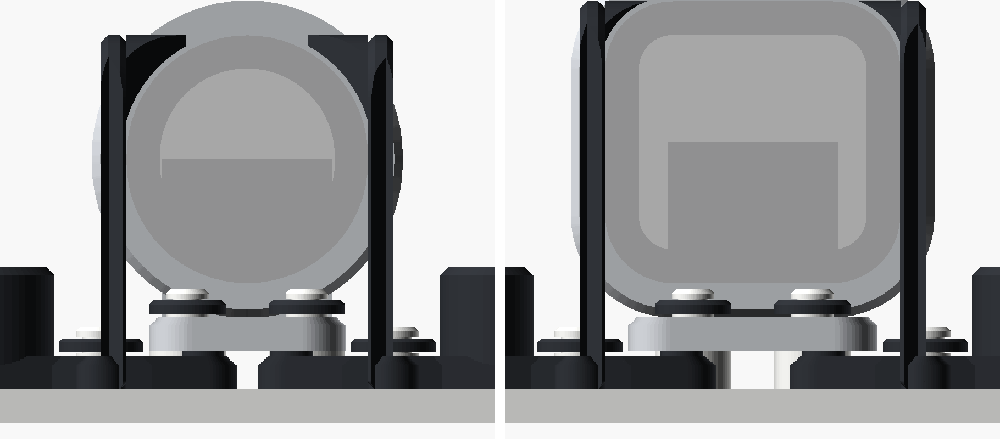
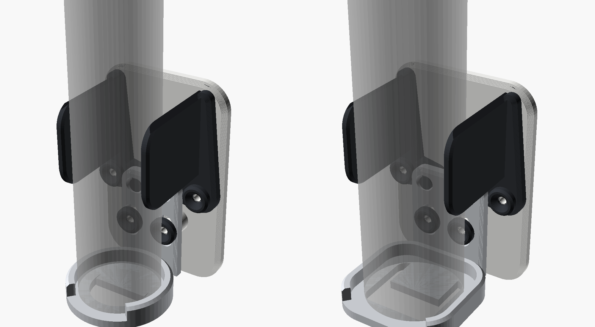
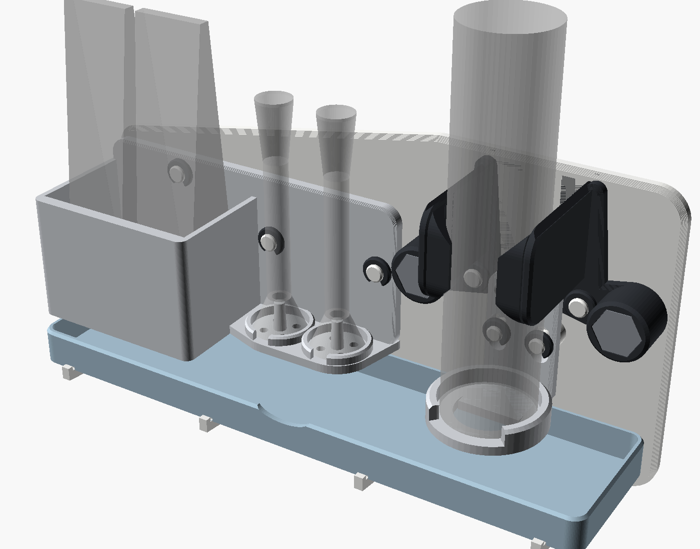
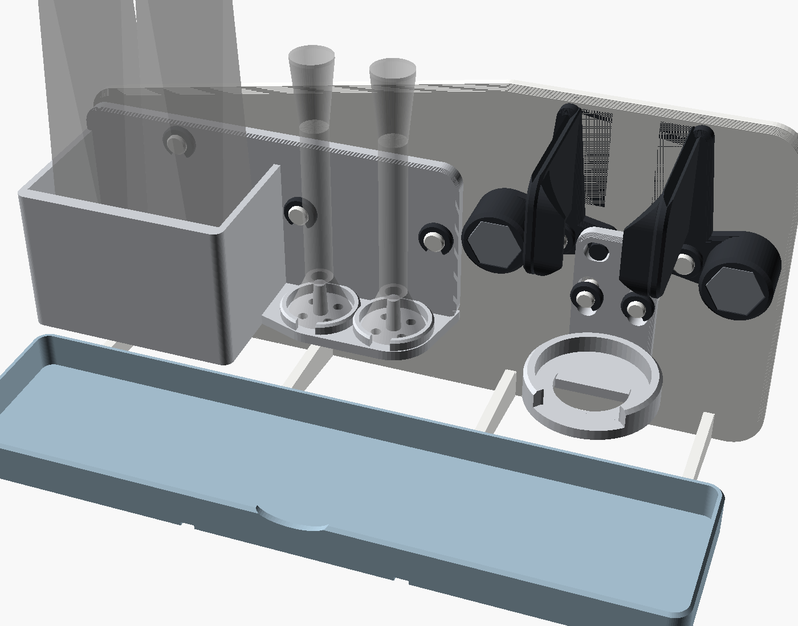
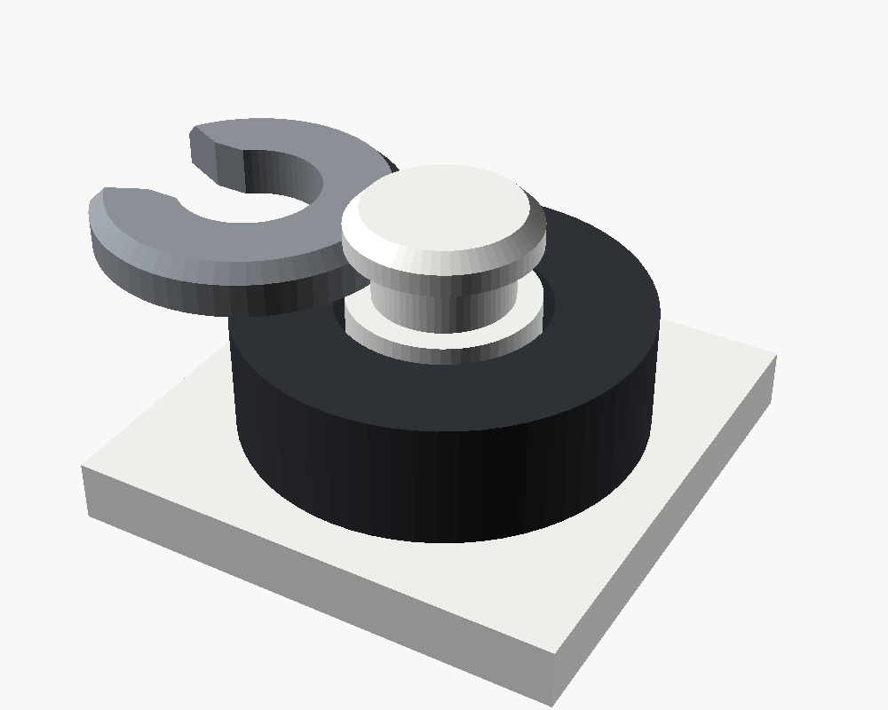

# Schwerkraft-Klemmhalter (Zahnbürste / Rasierer)

Eigene, parametrische Nachkonstruktion des Prinzips aus
[diesem Video](https://youtu.be/sRcxLJ-Aem0). Das Gerät steht in einer
Fußmulde. Sein Gewicht zieht einen Schlitten nach unten, und der Schlitten
klappt zwei Backen mit Haltekrallen um das Gerät. Hebt man das Gerät an,
klappen Gegengewichte die Backen von selbst wieder auf. Das Ganze kommt ohne
Feder aus und arbeitet nur mit Schwerkraft.


Links: leer, die Backen stehen offen. Rechts: mit Gerät, die Backen sind
geschlossen und die Krallen halten das Gerät vorne fest.


Draufsicht: Die Krallen greifen vorne um das Gerät (links Mijia, rechts OneBlade).



## Fertige Varianten für deine Geräte



| Variante | Gemessen (Unterseite) | Fußmulde | Klemmbereich | Ordner |
|---|---|---|---|---|
| Xiaomi Mijia Zahnbürste | 28,4 × 29,2 mm, rund | 30,6 × 31,4 mm, rund | ca. 24–45 mm | `stl/mijia/` |
| Philips OneBlade Pro 360 (QP6541) | 34,7 × 33,2 mm, abgerundet-eckig | 36,8 × 35,3 mm, Eckradius 9 mm | ca. 30–50 mm | `stl/oneblade/` |

In jedem Ordner liegen alle Einzelteile und eine komplette Druckplatte
(`print_plate_all.stl`, max. 200 × 144 mm; Mijia: zwei Platten, siehe unten). In OpenSCAD wählst du die Variante
mit `preset = "mijia"` oder `preset = "oneblade"`. Bei `preset = "custom"`
gelten die eigenen `c_…`-Werte. Die STLs direkt in `stl/` sind die
30-mm-Standardvariante.

Die Öffnung im Boden der Fußmulde bleibt frei. Ladebuchse bzw. Ladekontakte
sind erreichbar, und Wasser läuft ab.

### Ablage für Bürstenköpfe (Mijia)



Die Mijia-Variante hat rechts einen Flügel an der Wandplatte mit einer Ablage für
**2 Ersatz-Bürstenköpfe** (`stl/mijia/caddy.stl`). Jeder Kopf steckt aufrecht auf
einem leicht konischen Zapfen (passend zum gemessenen Loch von 4,88 mm) und steht
in einem Ring für den Fuß (gemessen 18,43 mm). Ablauflöcher und eine Lücke vorne
im Ring lassen Wasser abfließen. Die Ablage wird wie die Arme auf zwei Zapfen
gesteckt und mit zwei großen Clips gesichert, also auch ohne Schrauben.

Anzahl der Plätze: `head_slots` (−1 = automatisch, 0 = keine Ablage, 1–4).
Andere Bürstenköpfe: `head_base_d` und `head_hole_d` anpassen.

### Fach für Zahnpastatuben und Abtropfschale (Mijia)

Direkt neben den Bürstenköpfen sitzt ein **Fach für 2 Zahnpastatuben**, die mit dem
Deckel nach unten stehen (innen 58 × 36 mm, 40 mm hoch, Ablaufschlitze im Boden).
Es ist Teil der Ablage und wird zusätzlich mit einem dritten Clip gehalten.

Unter Zahnbürste, Bürstenköpfen und Tuben liegt eine **herausnehmbare
Abtropfschale**. Sie liegt lose auf vier Rippen der Wandplatte. Führungsleisten
und kleine Stopper verhindern, dass sie verrutscht. **Zum Reinigen:** Schale vorne
etwa 2 mm anheben und nach vorne herausziehen, ausspülen, wieder einlegen.



Tubenfach: `tube_slots` (−1 = automatisch, 0 = aus), Größe mit `tube_box`.
Abtropfschale: `drip_tray` (−1 = automatisch bei Mijia, 0 = aus, 1 = auch bei den
anderen Varianten).

## So funktioniert's

1. **Leer:** Jeder Arm trägt außen ein rundes Gegengewicht mit 2 M8-Muttern.
   Es kippt die Backen auf und drückt dabei über die Hebel den Schlitten nach
   oben. Der Halter steht offen bereit.
2. **Einsetzen:** Das Gerät von oben in die Fußmulde stellen. Sein Gewicht
   zieht den Schlitten nach unten. Die Hebel (12 mm) ziehen die Arme herum,
   und die Backen schließen sich ums Gerät. Die Übersetzung ist etwa 1 : 2,5.
3. **Festhalten:** Vorne an jeder Backe sitzt eine Kralle, die bis zu 7 mm um die
   Vorderseite des Geräts greift. Nach vorne kann es nicht herausfallen.
4. **Herausnehmen:** Gerät anheben. Sobald sein Gewicht vom Fuß weg ist,
   klappen die Gegengewichte die Backen auf. Das Gerät kommt nach oben frei,
   im offenen Zustand sogar nach vorne.

Nachgerechnet aus den Bauteilvolumen (PETG, ~75 % effektive Füllung,
M8-Mutter ≈ 5,3 g):

| | Mijia | OneBlade |
|---|---|---|
| Arm / Schlitten | 7,0 g / 6,3 g | 7,0 g / 8,4 g |
| Öffnendes Moment pro Arm (2 Muttern) | 179 g·mm | 180 g·mm |
| Schlitten schließt mit | 38 g·mm | 50 g·mm |
| Gerät schließt den Halter ab | ca. 23 g | ca. 22 g |

Beide Geräte sind deutlich schwerer. Je schwerer das Gerät, desto fester
greifen die Backen.

## Teile und Material

| Datei | Anzahl | Druckhinweis |
|---|---|---|
| `backplate.stl` | 1 | Rückseite auf dem Druckbett |
| `slider.stl` | 1 | steht auf dem Boden der Fußmulde |
| `arm_right.stl` / `arm_left.stl` | je 1 | flach, Backe und Gegengewicht zeigen nach oben |
| `clip_pivot.stl` | 2 | Sicherungsclip für die Arm-Drehpunkte (flach drucken) |
| `clip_guide.stl` | 2 | Sicherungsclip für die Schlittenführung (flach drucken) |
| `mijia/caddy.stl` | 1 | Ablage für Bürstenköpfe und Tuben, steht auf dem Boden (nur Mijia) |
| `mijia/drip_tray.stl` | 1 | Abtropfschale (nur Mijia) |

Die Mijia-Variante ist auf **zwei Druckplatten** verteilt, weil die Wandplatte breiter ist:
`mijia/print_plate_1.stl` (Wandplatte, Schlitten, 7 Clips; 204 × 160 mm) und
`mijia/print_plate_2.stl` (Abtropfschale, Arme, Ablage; 198 × 163 mm).

Keine Stützstrukturen nötig. Empfehlung: PETG (Bad), 0,2 mm Schichthöhe,
4 Wände, 25 % Infill. Farbvorschlag: Wandplatte weiß, Schlitten hellgrau, Arme
anthrazit matt.

**Ohne Schrauben – nur Steckverbindungen:** Die Zapfen für Arme und Schlitten
sind an die Wandplatte angedruckt. Jeder Zapfen hat vorne eine Nut, in die ein
gedruckter Sicherungsclip seitlich einrastet (wie ein E-Clip). Die Clips werden
flach gedruckt und federn deshalb in der Druckebene, statt an Schichtgrenzen zu
brechen. Lösen: mit einem kleinen Schraubendreher an der Öffnung heraushebeln.



**Zukaufteile:** nur 4 × Mutter M8 (DIN 934) als Gegengewichte, je 2 pro Arm.
Sie halten nichts zusammen, sie sind nur Gewicht. Mit einem Tropfen Kleber in der
Tasche sichern.

**Wand:** doppelseitiges Klebeband (z. B. 3M VHB) auf der Rückseite, oder
`wall_screws = true` setzen. Dann gibt es zwei Senkbohrungen.

## Zusammenbau

1. Je 2 M8-Muttern in die Gegengewichte der Arme drücken.
2. Arme auf die äußeren Zapfen der Wandplatte stecken und mit den großen Clips
   (`clip_pivot`) seitlich sichern – sie rasten hörbar ein.
3. Schlitten auf die beiden unteren Zapfen stecken. Dabei müssen die Zapfen der
   Arme in die waagrechten Langlöcher des Schlittens greifen. Mit den kleinen
   Clips (`clip_guide`) sichern.
4. Prüfen: Leer klappen die Backen von selbst auf. Mit Gerät schließen sie.
   Etwas Spiel (0,4 mm) ist gewollt, damit nichts klemmt.

## Feinabstimmung

- **Backen gehen leer nicht auf:** Zapfen und Löcher auf Grate prüfen, ggf. mit
  etwas Trockenschmiermittel (PTFE) gängig machen. Falls das nicht reicht,
  `cw_x` vergrößern (Gegengewicht weiter außen).
- **Clip zu stramm oder zu locker:** Der Clip muss sich 0,7–0,9 mm aufbiegen.
  Bricht er, PETG statt PLA nehmen; sitzt er locker, `groove_d` bzw.
  `ggroove_d` um 0,2 mm verkleinern.
- **Backen greifen mit Gerät zu schwach:** pro Arm nur 1 Mutter einsetzen
  (`nuts = 1` macht die Tasche kürzer) oder die Backen mit TPU/Gummi bekleben.
- **Gerät sitzt zu stramm hinter den Krallen:** `lip` verkleinern oder
  `lip_clr` vergrößern.

## Anpassen (OpenSCAD)

| Parameter | Standard | Bedeutung |
|---|---|---|
| `preset` | custom | `mijia`, `oneblade` oder `custom` |
| `c_dev_w` / `c_dev_d` / `c_dev_r` | 30 / 30 / 15 | Gerät: Breite, Tiefe, Eckradius |
| `c_foot_w` / `c_foot_d` / `c_foot_r` | 32 / 32 / 16 | Fußmulde: innen Breite, Tiefe, Eckradius |
| `lip` / `lip_clr` | 7 / 0,6 | Krallen: Übergriff und Spiel |
| `nuts` / `cw_x` | 2 / 15 | Gegengewicht: Muttern pro Arm, Abstand zum Drehpunkt |
| `pad_h` | 30 | Höhe der Backen |
| `edge` | 1,2 | Fase an den Sichtkanten |
| `travel_up` / `travel_down` | 4 / 3 | Schlittenweg (öffnen / schließen) |

Einzelteil exportieren:

```sh
openscad -D 'preset="mijia"' -D 'part="slider"' -o slider.stl gravity_clamp_holder.scad
```

Für die Ansicht `part="assembly"` wählen. Mit `s` (−4 … 3) bewegt man den
Schlitten.

## Geprüft

- **Keine Kollisionen:** Alle Teile wurden für Standard, Mijia und OneBlade in
  drei Schlittenstellungen (offen, neutral, geschlossen) geprüft. Dabei waren
  die Clips und das eingesetzte Gerät mit drin.
- **Steckverbindung:** Ein Clip lässt sich nicht vom Zapfen schieben, und Arme
  bzw. Schlitten stoßen beim Abziehen nach vorn gegen die Clips, halten also.
- **Krallen:** Im geschlossenen Zustand stößt das Gerät schon nach 1 mm vorne
  an die Krallen. Nach oben kommt es frei. Im offenen Zustand lässt es sich
  auch nach vorne ohne Berührung herausziehen.
- **STLs:** Alle sind geschlossen (watertight) und liegen flach auf dem
  Druckbett. Die Druckplatten enthalten 8 getrennte Teile.

Nicht geprüft ist ein echter Druck. Reibung in den Gelenken und das tatsächliche
Druckgewicht beeinflussen die Balance. Dafür gibt es die Feinabstimmung oben.
Die Krallenunterseite folgt der Geräteform. Beim OneBlade mit seinen engeren
Ecken entsteht dort geschätzt bis zu etwa 60° Überhang (nicht nachgemessen). Das druckt normalerweise ohne Stützen, kann aber leicht unsauber
werden.
