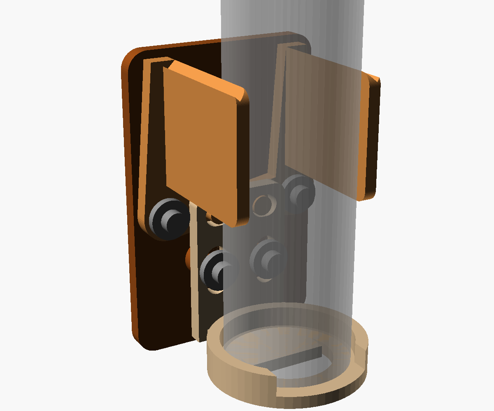
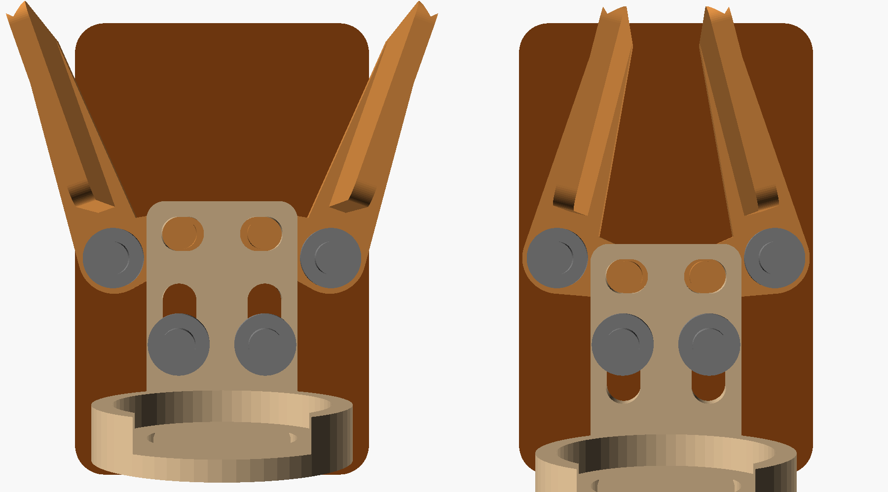

# Schwerkraft-Klemmhalter (Zahnbürste / Rasierer)

Eigene, parametrische Nachkonstruktion des Prinzips aus
[diesem Video](https://youtu.be/sRcxLJ-Aem0): Das Gerät steht in einem Fußring,
sein Gewicht zieht einen Schlitten nach unten und der Schlitten klappt zwei
seitliche Backen gegen das Gerät. Hebt man das Gerät heraus, öffnen die Backen
wieder.



Links: offen (Schlitten oben). Rechts: leer/geschlossen (Schlitten unten).



## So funktioniert's

- Jeder Arm dreht sich um eine M3-Schraube in der Wandplatte.
- Ein kurzer Hebel (12 mm) zeigt zur Mitte. Sein Zapfen steckt in einem
  waagrechten Langloch im Schlitten.
- Wenn der Schlitten nach unten geht, zieht er die Hebel mit. Die Arme drehen
  sich dadurch und die Backen (ca. 20–35 mm über dem Drehpunkt) schwenken
  nach innen. Übersetzung etwa 1 : 2,5.
- Beim Einsetzen drückt das Gerät die oben angefasten Backen auseinander. Das
  hebt den Schlitten, bis das Gerät im Fußring steht. Dann zieht das Gewicht
  die Backen zu.

## Teile

| Datei | Anzahl | Druckhinweis |
|---|---|---|
| `stl/backplate.stl` | 1 | Rückseite auf dem Druckbett |
| `stl/slider.stl` | 1 | steht auf dem Boden des Fußrings |
| `stl/arm_right.stl` | 1 | flach, Backe zeigt nach oben |
| `stl/arm_left.stl` | 1 | gespiegelt |
| `stl/washer.stl` | 4 | oder normale M3-Unterlegscheiben (max. Ø 10 mm) |
| `stl/print_plate_all.stl` | – | alles zusammen auf einer Platte (153 × 141 mm) |

Keine Stützstrukturen nötig. Empfehlung: PETG (Bad), 0,2 mm Schichthöhe,
4 Wände, 25 % Infill.

**Schrauben:** 2 × M3×8 (Drehpunkte der Arme), 2 × M3×12 (Führung des
Schlittens). Sie werden direkt in die 2,6-mm-Bohrungen der Dome geschraubt
(selbstschneidend). Nur so fest anziehen, dass Arme und Schlitten noch leicht
laufen.

**Wand:** doppelseitiges Klebeband (z. B. 3M VHB) auf der Rückseite, oder
`wall_screws = true` setzen. Dann gibt es zwei Senkbohrungen.

## Zusammenbau

1. Schlitten auf die beiden unteren Dome stecken (die Langlöcher zeigen nach
   unten) und mit Scheibe + M3×12 sichern.
2. Arme auf die Drehpunkt-Dome stecken, sodass die Zapfen in den waagrechten
   Langlöchern des Schlittens sitzen. Mit Scheibe + M3×8 sichern.
3. Prüfen: Schlitten hochschieben → Backen öffnen; loslassen → Backen schließen.

## Anpassen (OpenSCAD)

Die Parameter oben in `gravity_clamp_holder.scad` sind auch im Customizer
einstellbar:

| Parameter | Standard | Bedeutung |
|---|---|---|
| `dev_w` | 30 | Breite des Geräts auf Klemmhöhe |
| `dev_d` | 30 | Tiefe des Geräts |
| `foot_d` | 32 | Innendurchmesser des Fußrings |
| `pad_h` | 30 | Höhe der Backen |
| `travel_up` / `travel_down` | 4 / 3 | Schlittenweg (öffnen / schließen) |

Mit den Standardwerten klemmt der Halter Geräte mit 26–40 mm Breite. Am besten
vor dem Drucken die eigene Bürste bzw. den OneBlade messen: Breite auf ca.
4–6 cm Höhe und den Durchmesser des Fußes.

Einzelteil exportieren:

```sh
openscad -D 'part="slider"' -D dev_w=32 -o slider.stl gravity_clamp_holder.scad
```

Für die Ansicht `part="assembly"` wählen. Mit `s` (−4 … 3) bewegt man den
Schlitten.

## Geprüft

Alle Teile wurden in drei Schlittenstellungen (offen, neutral, geschlossen) auf
Überschneidungen geprüft. Dabei waren Schraubenköpfe, Scheiben und ein
eingesetztes 30-mm-Gerät mit drin: keine Kollisionen. Alle STLs sind
geschlossen (watertight) und liegen flach auf dem Druckbett.

Nicht geprüft ist ein echter Druck. Die Klemmkraft hängt von Reibung und
Spiel ab. Wenn die Backen zu schwach greifen, `lever` verkleinern oder die
Backen mit einem Streifen TPU/Gummi bekleben.
